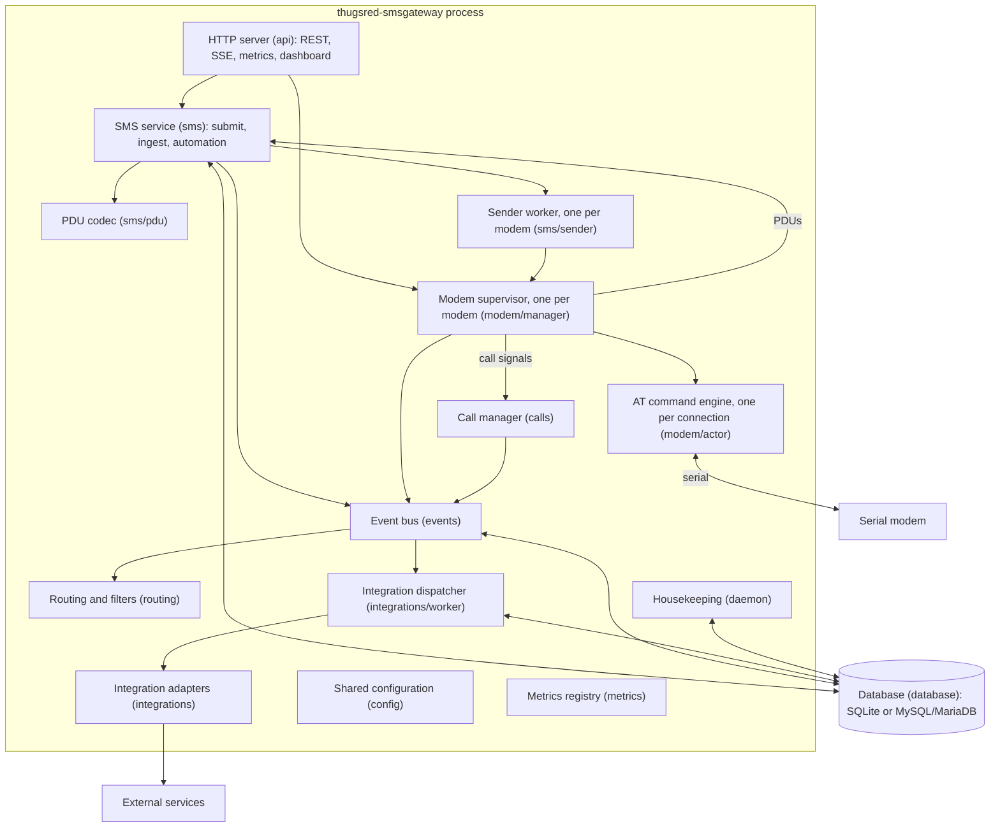
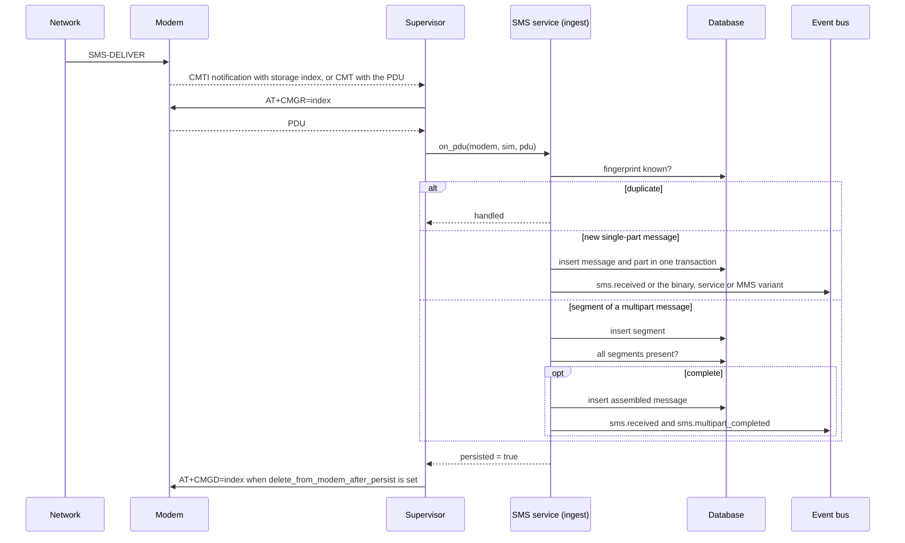
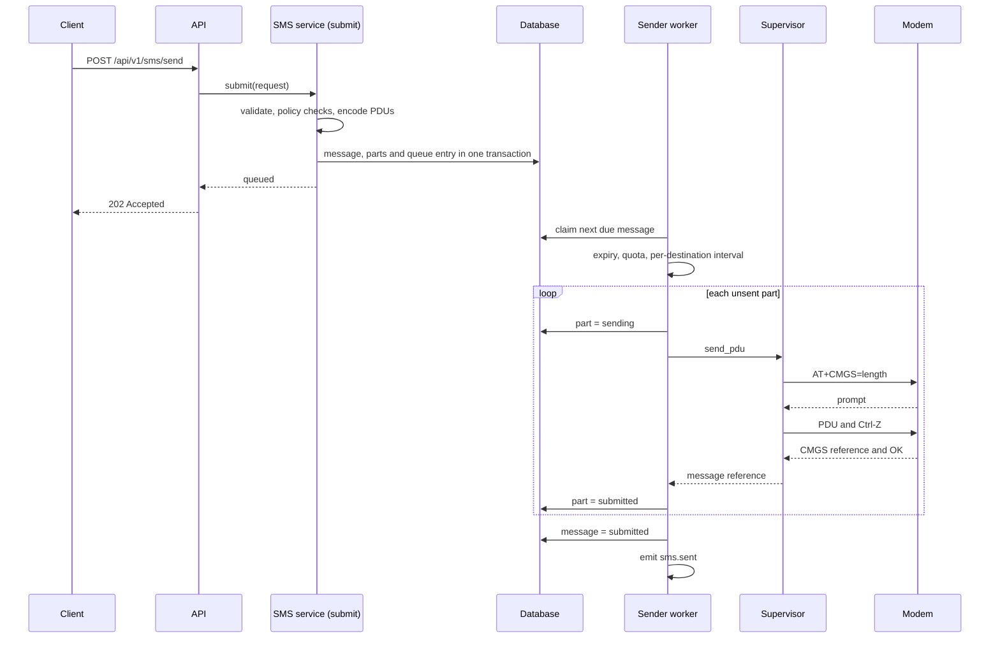
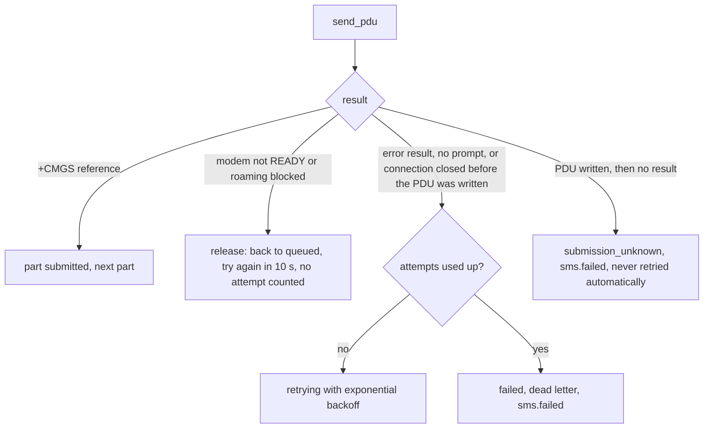
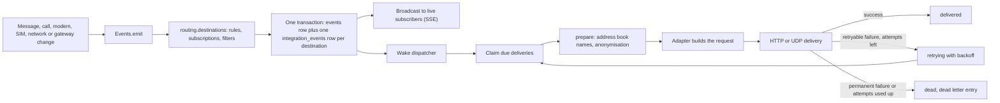
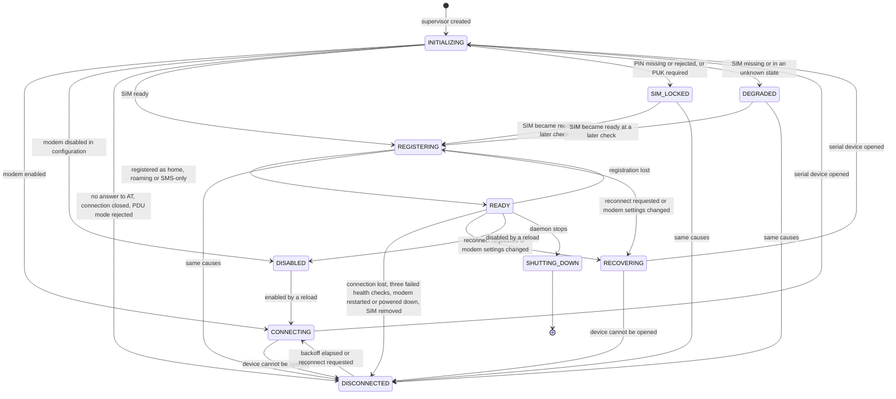

# Architecture

THUGSred-smsGateway is one process built on the Tokio asynchronous runtime. This document
describes its components, the tasks it runs, how data flows through it and how a modem moves
through its states.

- [Components](#components)
- [Task model](#task-model)
- [Inbound flow](#inbound-flow)
- [Outbound flow](#outbound-flow)
- [Events and integrations](#events-and-integrations)
- [Modem state machine](#modem-state-machine)
- [Configuration handling](#configuration-handling)
- [Startup and shutdown](#startup-and-shutdown)
- [Module map](#module-map)

## Components

| Component | Responsibility |
| --- | --- |
| AT command engine | Owns the serial stream of one connection. Executes AT commands strictly one at a time from a bounded queue and forwards unsolicited result codes on a separate channel. |
| Modem supervisor | Connection lifecycle of one modem: open, handshake, identification, profile selection, capability detection, SIM handling, registration monitoring, health checks, polling stored messages, and executing requests (send PDU, USSD, raw AT, answer, hang up). Everything that touches the serial line goes through this task. |
| SMS service | Validates and queues outbound messages; processes inbound PDUs (deduplication, classification, multipart assembly, delivery-report correlation); runs automation rules. |
| Sender worker | The only place that hands PDUs of queued messages to a modem. Applies rate limits, quotas, retries and the ambiguous-submission rule. |
| PDU codec | Pure encoder and decoder for SMS-SUBMIT, SMS-DELIVER and SMS-STATUS-REPORT. Never talks to a modem. |
| Call manager | Turns `RING`, caller ID and call-end signals into call records and events; optional auto-answer and recording. |
| Event bus | Persists every event together with its integration deliveries (a durable outbox) and broadcasts it to live subscribers (the event stream). |
| Routing | Decides which integrations receive an event (routing rules, subscriptions, filters). |
| Integration dispatcher | Claims due deliveries from the database and delivers them with retries, backoff, per-integration rate limits and dead-lettering. |
| Integration adapters | Build the request for each integration type. Payload construction is pure; one shared sender performs the HTTP or UDP delivery. |
| HTTP server | Access control, REST handlers, OpenAPI document, Prometheus metrics, Server-Sent Events, embedded dashboard. |
| Housekeeping | Queue expiry, incomplete multipart flush, gauges, low-disk warning, retention. |
| Database layer | One code path for SQLite and MySQL/MariaDB through the sqlx `Any` driver; embedded migrations. |

## Task model

`Gateway::start` spawns the long-running tasks. With *n* configured modems:

| Task | Count | Wakes up on |
| --- | --- | --- |
| Modem supervisor | *n* (also for modems that are disabled in the configuration) | Unsolicited result codes, requests, timers (health check, stored-message poll, registration poll, GNSS poll, configuration check every 5 s) |
| AT command engine | one per open connection, started by the supervisor | Serial data, queued commands, command deadline |
| Sender worker | *n* | New work (`wake` notification), modem status change, 2 s timer |
| Call manager | 1 | Call signals, 500 ms tick |
| Integration dispatcher | 1 loop plus up to `integrations.worker_count` concurrent deliveries | New deliveries, 2 s timer |
| Housekeeping | 1 | Every 15 s; retention every `retention.cleanup_interval_seconds` |
| HTTP server | 1 accept loop plus one task per connection | Requests |
| systemd watchdog | 1, only when the unit sets `WatchdogSec` | Half the watchdog period; reports liveness only while the database answers |
| Signal loop | main task | `SIGHUP` (reload), `SIGTERM` / `SIGINT` (shutdown) |

All tasks share one shutdown signal and the current configuration through an atomically
swappable pointer.

## Inbound flow

Points worth knowing:

- **Two arrival paths.** Unsolicited notifications (`+CMTI`, `+CDSI`, `+CMT`, `+CDS`) and a
  periodic poll of the modem's storage (`AT+CMGL=4` every `modem.poll_interval_seconds`). The
  poll is the safety net for anything that arrived while the gateway was not listening.
- **Persist before delete.** A PDU is deleted from the modem only after the database write
  succeeded (or the PDU was recognised as a duplicate). If the write fails, the PDU stays on
  the modem, a `gateway.error` event is emitted, and the next poll tries again.
- **Deduplication.** The fingerprint is the SHA-256 of the receiving modem's id and the
  complete PDU. See [DATABASE.md](DATABASE.md#deduplication-fingerprints).
- **Undecodable PDUs** are stored as raw records with status `malformed`, so nothing is lost.
- **Multipart.** Segments are grouped by modem, sender, reference number, total and reference
  width. If a slot is filled a second time with different content, the reference was reused:
  the old group is stored as `incomplete` and a new group starts. Groups whose newest segment
  is older than `sms.multipart_timeout_seconds` are stored as `incomplete` by housekeeping,
  with `[...]` marking each missing text segment.
- **Classification.** `mms_notification` or `wap_push` (destination port 2948/2949),
  `service` (message-waiting indication or certain protocol identifiers), `binary` (8-bit data
  or application ports), `flash` (class 0), otherwise `sms`.
- **Delivery reports** take the same path and are matched to a sent part by modem, message
  reference and recipient within `sms.delivery_report_window_days`.

## Outbound flow

Outcome of handing one part to the modem:

### The `submission_unknown` rule

Once the PDU and Ctrl-Z have been written to the modem, the modem may transmit the message
even if the gateway never sees the result (timeout, serial failure, daemon stopped). Sending
again could deliver and bill the message twice. Therefore:

- a timeout **before** the data prompt is a definite failure (the gateway aborts data entry
  with ESC) and is retried normally;
- a timeout or connection loss **after** the PDU was written marks the part `unknown` and the
  message `submission_unknown`. It is not retried automatically;
- at startup, a message that was `processing` with a part in state `sending` is resolved the
  same way; messages that were claimed but had no part in flight go back to `queued`;
- an operator decides: `POST /api/v1/queue/{id}/retry` sends the uncertain parts again
  (parts already accepted by the network are not resent), or the message is left as it is.

Other rules:

- **Ordering:** higher priority first, then oldest first.
- **Which modem:** a message pinned with `modem` or `from` is only claimed by that modem's
  worker. Unpinned messages are claimed by any worker whose modem is `READY`, or only by the
  worker of `sms.default_modem` when that is set. A worker whose SIM quota is exhausted does
  not claim unpinned messages.
- **Deferrals do not consume attempts:** quota exhausted (pinned messages wait 10 minutes,
  unpinned ones are offered again after 20 seconds), per-destination interval, modem not
  ready.
- **Retries:** `sms.max_send_attempts` rejections, with a delay of
  `sms.send_retry_delay_seconds` doubling per attempt up to one hour.
- **Rate limit:** `sms.outbound_rate_limit_per_minute` segments per modem in a sliding
  minute.
- **Expiry:** messages not submitted within `sms.queue_expiry_seconds` become `expired`.

## Events and integrations

- Routing is decided **when the event is emitted**, with the configuration active at that
  moment, and written to the database in the same transaction as the event. Deliveries
  therefore survive a restart (`integrations.persistent_queue = true`).
- Anonymisation and address book enrichment run **after** routing, per integration, so
  filters always see the real values.
- Delivery is **at least once**: a delivery that was in flight when the daemon stopped is
  attempted again after restart.
- Event emission never fails the operation that caused it; errors are logged.

Details: [INTEGRATIONS.md](INTEGRATIONS.md).

## Modem state machine

The states are the values of `state` in `GET /api/v1/modem` and in `status` output.

| State | Meaning |
| --- | --- |
| `INITIALIZING` | Handshake, identification, capability detection and SIM check are running. Also the initial value before the first connection attempt. |
| `CONNECTING` | Opening the serial device (first attempt, or after a failure). |
| `RECOVERING` | Reopening the device after a requested reconnect or a change of this modem's settings. |
| `SIM_LOCKED` | The SIM needs a PIN that is missing or was rejected, or needs a PUK. |
| `DEGRADED` | The modem answers but the SIM is missing or reports an unusable state. |
| `REGISTERING` | SIM ready, not registered on a network yet. |
| `READY` | Registered. The only state in which messages are sent and USSD is accepted. |
| `DISCONNECTED` | No usable connection. `last_error` and `hint` say why. The supervisor retries after a backoff when `modem.auto_reconnect` is true; otherwise it waits for `modem reconnect`. |
| `DISABLED` | `enabled = false` for this modem. |
| `SHUTTING_DOWN` | The daemon is stopping. |

Further rules:

- **Readiness for sending** needs `READY`, and when the SIM is roaming also
  `network.roaming_enabled = true` in its SIM profile.
- **Registration** is taken from the circuit-switched (`+CREG`) or EPS (`+CEREG`) domain;
  GPRS registration alone does not count. It is polled every 3 seconds until registered and
  with every health check afterwards.
- **Health check** every `modem.healthcheck_interval_seconds`: `AT`, then signal and
  registration. Three consecutive failures end the session. While the SIM is not ready the
  health check re-evaluates it; a PIN that was already rejected is not entered again.
- **Backoff:** `reconnect_delay_seconds` doubling per attempt up to
  `max_reconnect_delay_seconds`. When the cause suggests a module that will be switched on by
  hand shortly (no answer to `AT`, modem restarted or powered down, SIM became unavailable)
  the cap is at most 20 seconds.
- **Events:** `modem.connected`, `modem.disconnected`, `modem.error` (once per distinct
  error), `sim.ready`, `sim.locked`, `network.registered`, `network.lost`,
  `modem.signal_changed` (change of 15 percentage points or more).

## Configuration handling

The configuration is loaded into one immutable structure and published through an atomically
swappable pointer. A reload builds a complete new structure, validates it, and swaps the
pointer only when it is valid; readers see either the old or the new configuration, never a
mixture. Modem supervisors compare their own settings every 5 seconds and reconnect when they
changed. See [CONFIGURATION.md](CONFIGURATION.md#reload-semantics).

## Startup and shutdown

Startup order: load configuration, initialise logging, create directories, connect to the
database, migrate (or verify the schema version), load modem profiles, recover the outbound
queue, start supervisors and sender workers, call manager, dispatcher (which recovers
in-flight deliveries), housekeeping, emit `gateway.started`, bind the HTTP listener, notify
systemd that the service is ready.

A listener that cannot be bound is fatal: the gateway shuts down and exits with an error.

Shutdown (`SIGTERM` or `SIGINT`): emit `gateway.stopped`, signal all tasks, wait up to
`general.shutdown_timeout_seconds`, close the database. Calls that are still open are closed
with the reason `gateway_shutdown`.

## Module map

| Path | Contents |
| --- | --- |
| `src/main.rs` | Entry point: parses the command line, starts the runtime |
| `src/lib.rs` | Library root |
| `src/cli/mod.rs` | Command definitions, HTTP client for the daemon, `pdu` and `db` commands |
| `src/cli/run.rs` | `run` (daemon main loop, signals, systemd notification) and `simulator` |
| `src/cli/doctor.rs` | `doctor` checks |
| `src/daemon.rs` | `Gateway`: wiring, reload, shutdown, housekeeping, retention |
| `src/config/model.rs` | Configuration data model and defaults |
| `src/config/mod.rs` | Loading, overrides, secret references, validation, redaction |
| `src/modem/actor.rs` | AT command engine |
| `src/modem/parser.rs` | Line buffer, final result and unsolicited result code parsing |
| `src/modem/manager.rs` | Supervisor: connection loop, backoff, request types |
| `src/modem/manager/init.rs` | Handshake, identification, capability detection, SIM unlock, SMS setup |
| `src/modem/manager/session.rs` | Connected phase: notifications, health, polling, requests |
| `src/modem/state.rs` | States, status snapshot, capabilities |
| `src/modem/profiles.rs` | Modem profiles and detection |
| `src/modem/transport.rs` | Serial connector and stream abstraction |
| `src/modem/simulator.rs` | Software modem |
| `src/sms/service.rs` | Submission rules, quotas, message log |
| `src/sms/sender.rs` | Outbound queue worker |
| `src/sms/inbound.rs` | Inbound processing |
| `src/sms/automation.rs` | Reply and forward rules |
| `src/sms/pdu/` | PDU codec (`types`, `gsm7`, `encode`, `decode`) |
| `src/mms.rs` | MMS notification decoding and optional retrieval |
| `src/calls.rs` | Call tracking, auto-answer, recording |
| `src/gnss.rs` | GNSS response parsing |
| `src/events.rs` | Event bus and message event payload |
| `src/routing.rs` | Routing rules and filters |
| `src/templates.rs` | Template rendering and escaping |
| `src/integrations/mod.rs` | Adapters, signing, anonymisation, delivery |
| `src/integrations/worker.rs` | Dispatcher |
| `src/api/mod.rs` | Router, access control, error format |
| `src/api/handlers.rs` | Request handlers |
| `src/api/openapi.rs` | OpenAPI document |
| `src/api/web.rs` | Embedded dashboard assets |
| `src/database/` | Database layer (`mod`, `messages`, `queue`, `misc`, `models`) |
| `src/logging.rs` | Log files, rotation, journal output |
| `src/metrics.rs` | Metrics registry |
| `src/utils.rs` | Timestamps, identifiers, number handling, masking, backoff |
| `migrations/` | SQL schema for SQLite and MySQL/MariaDB |
| `web/` | Dashboard sources (embedded at build time) |
