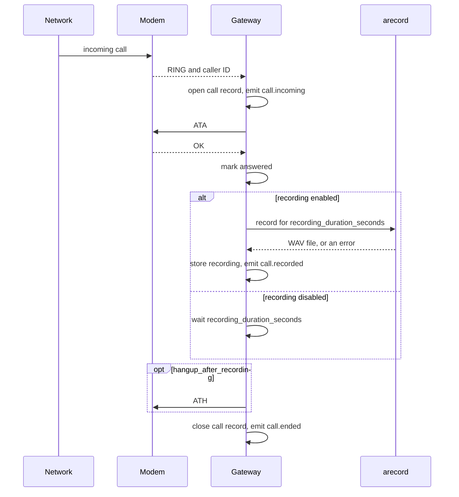

# Calls

The gateway is an SMS gateway first. Its call support is limited to noticing calls, logging
them, and optionally answering and recording a few seconds of audio.

> **Unverified.** Call detection, auto-answer and the call log have been tested against the
> software simulator only. Recording has been tested only for its failure paths (no device,
> no recorder), because it needs audio hardware. Nothing in this document has been verified
> on a real modem.

- [What is detected](#what-is-detected)
- [What is logged](#what-is-logged)
- [Auto-answer flow](#auto-answer-flow)
- [Recording requirements](#recording-requirements)
- [Recording statuses](#recording-statuses)
- [Configuration](#configuration)
- [Privacy, consent and law](#privacy-consent-and-law)
- [Limitations](#limitations)

## What is detected

The modem announces calls with unsolicited result codes on the AT port. The gateway enables
caller ID presentation (`AT+CLIP=1`) during initialisation and reacts to:

| Modem output | Meaning for the gateway |
| --- | --- |
| `RING`, `+CRING:` | An incoming call is ringing. The first one opens a call record; later ones keep it alive. |
| `+CLIP: "<number>",...` | Caller ID. Sets the number of the open call and announces it. |
| `NO CARRIER`, `BUSY`, `NO ANSWER`, `NO DIALTONE` | The call ended; the text becomes the termination reason (`no_carrier`, `busy`, `no_answer`, `no_dialtone`) |

Timing rules:

- A call is announced (`call.incoming`) as soon as caller ID arrives, or 1.5 seconds after
  the first `RING` when no caller ID is presented. The number is then `null`.
- An unanswered call whose ringing stops is closed as **missed** when no `RING` has been seen
  for `calls.ring_timeout_seconds` (default 8; modems repeat `RING` every few seconds). The
  termination reason is `ring_timeout`. A `NO CARRIER` before that closes it immediately.
- One call per modem is tracked at a time.
- If the modem connection is lost during a call, the call is closed with the reason
  `modem_disconnected`; at daemon shutdown with `gateway_shutdown`. Call records left open
  by a crash are closed at the next start.

**Outgoing calls** are only known to the gateway when they are dialled through the raw AT
endpoint (`ATD...`, which requires `security.allow_raw_at_commands`). They are logged with
direction `outgoing` when `calls.log_outgoing` is true. The gateway has no dialling feature
of its own.

## What is logged

Each call is a row in the `calls` table, returned by `GET /api/v1/calls` and shown on the
dashboard's Calls page:

| Field | Content |
| --- | --- |
| `id` | Call id (UUID) |
| `modem_id` | Modem that saw the call |
| `direction` | `incoming` or `outgoing` |
| `number` | Caller (or dialled) number, `null` when withheld |
| `state` | `ringing` or `dialing` while open, then `missed` or `ended` |
| `answered`, `missed` | Flags |
| `started_at`, `answered_at`, `ended_at` | Times (UTC) |
| `duration_seconds` | Time from answering to the end, for answered calls |
| `termination_reason` | `no_carrier`, `busy`, `no_answer`, `no_dialtone`, `ring_timeout`, `gateway_hangup`, `modem_disconnected`, `gateway_shutdown` |
| `recording_status`, `recording_id` | See [Recording statuses](#recording-statuses) |

Events: `call.incoming`, then `call.missed` or `call.ended`, and `call.recorded` when a
recording was saved. Their payloads are described in
[INTEGRATIONS.md](INTEGRATIONS.md#the-call-object). Caller numbers in integrations follow the
anonymisation rules; in `messages.log` they are masked like other numbers.

The call log is not covered by retention in this release; recordings are
(`retention.recording_days`).

## Auto-answer flow

With `calls.auto_answer = true`:



- The call is answered right after it is announced.
- If `ATA` fails, the call stays unanswered and ends up as missed.
- After answering, the gateway holds the call for `calls.recording_duration_seconds`,
  recording if enabled, and then hangs up when `calls.hangup_after_recording` is true (the
  default; termination reason `gateway_hangup`). With `hangup_after_recording = false` the
  call stays up until the caller or the network ends it.
- If recording fails immediately, the hold time is not waited out; the gateway hangs up at
  once.
- The caller hears whatever the modem's audio input carries, typically silence. The gateway
  plays no greeting or announcement.

Without auto-answer, calls ring until the caller gives up and are logged as missed.

## Recording requirements

> The AT serial line carries commands only, never audio. The gateway cannot extract call
> audio from the modem through the serial port.

Recording therefore needs **all** of the following:

1. **An audio path from the modem to the host.** The modem's audio output (analogue speaker
   or headset output, or a digital audio interface offered by some modules) must be
   physically connected to an input of a sound device on the host, for example a USB sound
   card's line or microphone input. How to do that depends entirely on the board; it is
   your responsibility, and levels must match to avoid damage or distortion.
2. **An ALSA capture device** for that input, named in `calls.audio_device`, for example
   `"plughw:1,0"`. `arecord -l` lists devices; `GET /api/v1/capabilities` lists the capture
   devices the gateway sees (`audio.host_capture_devices`).
3. **`arecord`** from the `alsa-utils` package, on the service's `PATH`.
4. **Permission.** The service user must be in the `audio` group (the installer adds it; the
   unit lists it).
5. `calls.auto_answer = true` and `calls.recording_enabled = true`.

The gateway runs:

```text
arecord -q -D <audio_device> -f S16_LE -r 8000 -c 1 -t wav -d <seconds> <file>
```

that is: 16-bit, 8 kHz, mono WAV. The file is written to `paths.recordings` as
`call-<random id>.wav`; the name carries no caller information.

**The gateway never fabricates a recording.** A recording is only stored when `arecord`
exited successfully and the file is larger than 1 KiB (a bare WAV header is 44 bytes). In
every other case the file is removed and the status says what happened. The gateway cannot
tell whether the captured audio is actually the call: if the capture device is not wired to
the modem, you get a valid recording of silence or of whatever that input hears.

The capability `audio.call_recording` is `unsupported` when the host has no ALSA capture
device at all and `unverified` otherwise; it is never `supported`, for the reason above.

## Recording statuses

| `recording_status` | Meaning |
| --- | --- |
| `disabled` | Recording is not enabled, or the call was not answered |
| `recorded` | A recording was saved; `recording_id` refers to it |
| `unavailable` | Recording was enabled but impossible: `calls.audio_backend = "none"`, no `calls.audio_device` configured, or `arecord` is not installed. The call is still held for the configured duration. |
| `failed` | The recorder ran but failed, did not finish in time, or captured no audio; or the call ended before the outcome was known. The first line of the recorder's error is logged. |

List and download:

```sh
curl -sS http://127.0.0.1:8080/api/v1/recordings
curl -sS -OJ http://127.0.0.1:8080/api/v1/recordings/<recording id>/download
```

Downloads are served only from inside `paths.recordings` and are written to the audit trail.
They are not an administrative endpoint.

## Configuration

`[calls]` in `smsgateway.conf`; all fields apply on reload.

| Field | Default | Meaning |
| --- | --- | --- |
| `enabled` | `true` | Process call signals at all |
| `log_incoming` | `true` | Log incoming calls |
| `log_outgoing` | `true` | Log calls dialled through the raw AT endpoint |
| `auto_answer` | `false` | Answer incoming calls |
| `recording_enabled` | `false` | Record answered calls (needs `auto_answer`; the gateway warns otherwise) |
| `recording_duration_seconds` | `15` | 1 to 300; also the hold time without recording |
| `audio_backend` | `"auto"` | `auto` or `alsa` use ALSA; `none` disables recording |
| `audio_device` | `""` | ALSA capture device |
| `recording_format` | `"wav"` | Only `wav` |
| `hangup_after_recording` | `true` | Hang up after the hold time |
| `ring_timeout_seconds` | `8` | Seconds without `RING` before an unanswered call counts as missed |

Related: `paths.recordings`, `retention.recording_days` (default 30), and the `voice` and
`audio_interfaces` fields of modem profiles, which are descriptive.

Example:

```toml
[calls]
auto_answer = true
recording_enabled = true
recording_duration_seconds = 20
audio_device = "plughw:1,0"
```

Forward missed calls without numbers to a chat channel:

```toml
[[integration]]
name = "missed-calls"
type = "slack"
enabled = true
events = ["call.missed"]
webhook_url = "${SLACK_WEBHOOK_URL}"
anonymize = true
```

## Privacy, consent and law

> **Check the law before enabling auto-answer or recording.** Recording telephone calls is
> regulated in many jurisdictions. Depending on where you and the caller are, it may require
> the consent of one or of all parties, a prior announcement, or it may be prohibited.
> Recordings and call logs are usually personal data under data-protection law. This
> documentation is not legal advice.

Things the gateway does **not** do: it does not announce that the call is recorded, does not
play a consent prompt, and cannot ask the caller anything. If your jurisdiction requires
notice or consent, the gateway's recording feature cannot provide it on its own.

Practical measures:

- Leave `auto_answer` and `recording_enabled` off unless you have a clear, lawful purpose.
- Keep `retention.recording_days` short.
- Restrict API access: recordings can be downloaded by anyone who can use the API.
- Use `anonymize = true` on integrations that receive call events, or list numbers in
  `anonymous.conf`.
- Recordings are unencrypted files in `paths.recordings` (mode `0750` directory owned by the
  service account). Include them in, or deliberately exclude them from, your backups.

## Limitations

- Unverified on real hardware (see the top of this page).
- No outgoing call feature, no call control beyond answer and hang up, no DTMF, no audio
  playback, no voicemail.
- One tracked call per modem; call waiting notifications are ignored.
- Recording length is fixed in advance (at most 300 seconds); it does not follow the actual
  length of the call.
- Recording quality and content depend entirely on your audio wiring; the gateway cannot
  verify either.
- Modem-side recording features (some modules can record to their own storage) are not used.
- The call log has no retention setting.
- While a call is being answered or hung up, those AT commands share the serial line with
  SMS traffic; messages wait for them like for any other command.
