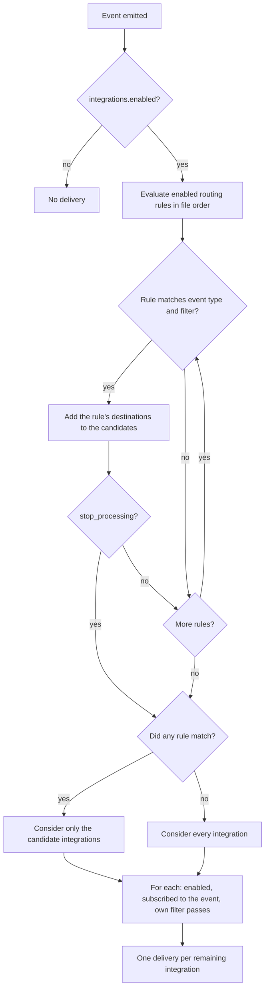

# Integrations, routing and automation

Integrations forward gateway events to other systems. They are configured in
`/etc/thugsred/integrations.conf`; the field reference is in
[CONFIGURATION.md](CONFIGURATION.md#integrationsconf). Nothing is forwarded unless an
integration has `enabled = true`.

- [How delivery works](#how-delivery-works)
- [Events](#events)
- [Integration types and payloads](#integration-types-and-payloads)
- [Templates](#templates)
- [Filters](#filters)
- [Multiple integrations and fan-out](#multiple-integrations-and-fan-out)
- [Routing rules](#routing-rules)
- [Anonymisation](#anonymisation)
- [Address book](#address-book)
- [Webhook signatures](#webhook-signatures)
- [Retries, backoff and dead letters](#retries-backoff-and-dead-letters)
- [Rate limits](#rate-limits)
- [GET webhooks](#get-webhooks)
- [Automation rules](#automation-rules)
- [Testing and monitoring](#testing-and-monitoring)

Verification status: payload construction, routing, filtering, anonymisation, signing,
retries and dead-lettering are covered by automated tests against local test receivers. The
third-party services themselves (Discord, Slack, Microsoft Teams, Telegram, ntfy, Gotify)
were not contacted by the test suite.

## How delivery works

1. Something happens and the gateway emits an **event**.
2. **Routing** decides which integrations receive it: routing rules, each integration's
   `events` subscription and its filter. The decision is made once, at that moment.
3. The event and one **delivery** per destination are stored in the database in a single
   transaction.
4. The dispatcher picks deliveries up, **prepares** the event for each integration (address
   book names, anonymisation), builds the request and sends it.
5. Failed deliveries are retried with backoff and finally become **dead letters**.

Consequences:

- Delivery is **at least once**. A receiver can get the same event more than once (after a
  restart, or when its response was lost); use the event id to deduplicate.
- Deliveries are independent of each other and are **not ordered**: with several workers and
  retries, a later event can arrive before an earlier one.
- One request per event. There is no batching.
- HTTP redirects are not followed. Every request carries the header
  `User-Agent: THUGSred-smsGateway/<version>`.
- Supported transports are HTTP(S) and UDP syslog. MQTT is not supported.

## Events

Subscriptions (`events = [...]`) accept exact names, `*` for everything, and prefix patterns
such as `sms.*`. Unknown names are a configuration error.

| Event | Emitted when | `data` |
| --- | --- | --- |
| `sms.received` | A text or flash SMS was stored (also for incomplete multipart messages) | `message` |
| `sms.multipart_completed` | All parts of a multipart message arrived; emitted in addition to `sms.received` | `message` |
| `sms.binary_received` | An 8-bit or port-addressed message was stored | `message` |
| `sms.service_received` | A service message or non-MMS WAP Push was stored (only with `sms.allow_service_messages`) | `message` |
| `sms.ota_toolkit` | A SIM Toolkit OTA message (S@T/WIB browser push) was received | `message` |
| `security.sim_attack` | A SIM Toolkit OTA push was received; raised in addition to `sms.ota_toolkit` for honeypot/alerting ([HONEYPOT.md](HONEYPOT.md)) | `message` |
| `sms.queued` | An outbound message was accepted into the queue | `message` |
| `sms.sent` | All parts were accepted by the network | `message` |
| `sms.delivered` | Delivery reports confirmed every part | `message` |
| `sms.failed` | Submission failed for good, the outcome is unknown, the message expired, or a delivery report reported failure | `message` (with `status` and `error`) |
| `mms.notification` | An MMS notification was received | `message` (type `mms_notification`, `body` is the subject) |
| `mms.received` | MMS content was downloaded (experimental) | `message` |
| `ussd.response` | A USSD request was answered, or the network sent an unsolicited USSD text | `modem_id`, `ussd` (`code`, `response`; `unsolicited: true` and `code: null` for network-initiated text) |
| `call.incoming` | An incoming call was detected | `call`, `modem_id` |
| `call.missed` | An incoming call ended unanswered | `call`, `modem_id` |
| `call.ended` | An answered or outgoing call ended | `call`, `modem_id` |
| `call.recorded` | A recording was saved | `call` (`id`, `modem_id`, `number`, `recording_id`, `recording_seconds`, `recording_bytes`), `modem_id` |
| `modem.connected` | A modem finished initialisation | `modem_id`, `manufacturer`, `model`, `firmware`, `profile` |
| `modem.disconnected` | A connected modem was lost | `modem_id`, `reason` |
| `modem.error` | A modem became unavailable (once per distinct error), or its SMS storage is nearly full | `modem_id`, `error`, `hint` |
| `modem.signal_changed` | The signal changed by 15 percentage points or more | `modem_id`, `signal_percent`, `rssi_dbm` |
| `sim.ready` | The SIM is usable | `modem_id`, `sim_id` |
| `sim.locked` | The SIM needs a PIN or PUK, is missing, or is in an unusable state | `modem_id`, `state`, `error` |
| `network.registered` | The modem registered on a network | `modem_id`, `registration`, `operator`, `technology` |
| `network.lost` | Registration was lost | `modem_id`, `registration` |
| `gnss.fix` | The first position fix was obtained | `modem_id`, `satellites` (never coordinates) |
| `gateway.started` | The daemon started | `version`, `commit`, `modems` |
| `gateway.stopped` | The daemon is stopping | `version` |
| `gateway.error` | A reload was rejected, an inbound message could not be stored, or disk space is low | `error`, sometimes `details` or `modem_id` |
| `gateway.config_reloaded` | A reload succeeded | `restart_required` |
| `integration.test` | Only produced by the test endpoint | `test: true` and a synthetic `message` |

### The `message` object

| Field | Meaning |
| --- | --- |
| `id` | Message id |
| `direction` | `inbound` or `outbound` |
| `type` | `sms`, `flash`, `binary`, `service`, `mms_notification`, `wap_push`, `raw_pdu` |
| `sender`, `recipient` | Numbers or alphanumeric sender. For inbound messages `recipient` is the `mobile_number` of the receiving SIM profile, or `null`. |
| `body` | Text, or `null` for binary messages |
| `encoding` | `gsm7`, `ucs2` or `8bit` |
| `class` | Message class or `null` |
| `parts` | Number of parts |
| `src_port`, `dst_port` | Application ports or `null` |
| `modem_id`, `sim_id` | Where it was received or sent |
| `status`, `delivery_status`, `error` | Message state |
| `network_timestamp`, `received_at`, `submitted_at`, `delivered_at` | Times (UTC) |
| `raw_pdu` | Hexadecimal PDU (first part), when stored |
| `payload` | Hexadecimal payload of binary messages |

Fields added per integration by the preparation step: `sender_name`, `recipient_name`
(address book name or `null`), `sender_display`, `recipient_display` (`Name (+number)`, the
plain number, or the anonymous label; an empty string when there is no number), and
`anonymized: true` when a number was replaced.

### The `call` object

`id`, `modem_id`, `direction` (`incoming` or `outgoing`), `number` (or `null` when no caller
ID was presented), `answered`, `recording_status`; for `call.missed` and `call.ended` also
`state`, `termination_reason`, `duration_seconds`, `recording_id`. Added per integration:
`name`, `display` (`unknown number` when there is none), and `anonymized` when replaced.

## Integration types and payloads

Options common to every type: `events`, `anonymize`, `include_message_body`,
`timeout_seconds`, `verify_tls`, `rate_limit_per_minute`, `max_attempts`,
`retry_initial_seconds`, `retry_max_seconds`, `[integration.filter]`.

"Text" below means the rendered `template`, or the built-in text for the event type when
`template` is empty.

### webhook

Options: `url`, `method` (`POST`, `PUT`, `GET`), `[integration.headers]`,
`[integration.query]`, `body_template`, `content_type`, `include_raw_pdu`, `sign_payload`,
`signing_secret`.

Headers added to every webhook request:

| Header | Value |
| --- | --- |
| `X-THUGSred-Event` | Event type |
| `X-THUGSred-Event-Id` | Event id (stable across retries) |
| `X-THUGSred-Timestamp` | Event timestamp (the time the event was created, not the time of the attempt) |
| `X-THUGSred-Signature` | Only with `sign_payload`; see [Webhook signatures](#webhook-signatures) |

Body for `POST` and `PUT` without a `body_template` — the event envelope, sent as
`application/json`:

```json
{
  "id": "0b9c2f4e-5a1d-4c3b-9e8f-000000000020",
  "type": "sms.received",
  "timestamp": "2026-11-24T11:00:03.150Z",
  "instance_id": "gateway-01",
  "correlation_id": "0b9c2f4e-5a1d-4c3b-9e8f-000000000003",
  "data": {
    "message": {
      "id": "0b9c2f4e-5a1d-4c3b-9e8f-000000000003",
      "direction": "inbound",
      "type": "sms",
      "sender": "+4500000002",
      "recipient": "+4500000000",
      "body": "Hello",
      "encoding": "gsm7",
      "class": null,
      "parts": 1,
      "src_port": null,
      "dst_port": null,
      "modem_id": "modem-1",
      "sim_id": "default",
      "status": "received",
      "delivery_status": null,
      "error": null,
      "network_timestamp": "2026-11-24T11:00:00.000Z",
      "received_at": "2026-11-24T11:00:03.120Z",
      "submitted_at": null,
      "delivered_at": null,
      "payload": null,
      "sender_name": "Example Person",
      "sender_display": "Example Person (+4500000002)",
      "recipient_name": null,
      "recipient_display": "+4500000000"
    }
  }
}
```

`correlation_id` is the message id for message events and the call id for call events.
`raw_pdu` is included only with `include_raw_pdu = true` (and never for anonymised or
body-redacted events).

With a `body_template`, the rendered template is the body and `content_type` is its content
type. Values are escaped according to the content type: JSON string escaping when it contains
`json`, URL encoding for `x-www-form-urlencoded`, HTML escaping for `html` or `xml`, no
escaping otherwise.

```toml
[[integration]]
name = "custom-json"
type = "webhook"
enabled = true
events = ["sms.received"]
url = "https://example.invalid/hook"
content_type = "application/json"
body_template = '{"from": "{{message.sender}}", "text": "{{message.body}}", "at": "{{event.timestamp}}"}'
```

Query parameters in `[integration.query]` are templates; the HTTP client URL-encodes the
rendered values. Header values in `[integration.headers]` are sent as written.

A response status of 2xx counts as delivered.

### discord

Options: `webhook_url`, `username`, `template`.

```json
{
  "content": "SMS from Example Person \\(+4500000002\\): Hello",
  "allowed_mentions": {"parse": []},
  "username": "THUGSred SMS Gateway"
}
```

Substituted values are Markdown-escaped, which is why the parentheses of the display name
carry backslashes; Discord renders them as plain parentheses. `content` is limited to 2000
characters (longer text is cut and ends with `…`), `username` to 80. `allowed_mentions` is always sent with an empty `parse` list, so that even an unescaped
mention cannot ping anyone.

### slack

Options: `webhook_url`, `template`.

```json
{"text": "SMS from Example Person (+4500000002): Hello"}
```

Limited to 3000 characters.

### teams

Options: `webhook_url` (the URL of a Workflows "When a Teams webhook request is received"
flow, the successor of Office 365 connectors), `template`.

```json
{
  "type": "message",
  "attachments": [{
    "contentType": "application/vnd.microsoft.card.adaptive",
    "contentUrl": null,
    "content": {
      "$schema": "http://adaptivecards.io/schemas/adaptive-card.json",
      "type": "AdaptiveCard",
      "version": "1.4",
      "body": [
        {"type": "TextBlock", "text": "THUGSred SMS Gateway", "weight": "Bolder", "size": "Medium", "wrap": true},
        {"type": "TextBlock", "text": "SMS from Example Person \\(+4500000002\\): Hello", "wrap": true},
        {"type": "TextBlock", "text": "sms.received · 2026-11-24T11:00:03.150Z", "isSubtle": true, "size": "Small", "wrap": true}
      ]
    }
  }]
}
```

The first block is `general.instance_name`, the second the text (limited to 4000 characters),
the third the event type and timestamp.

### telegram

Options: `bot_token`, `chat_id`, `template`, optional `url` (API base URL, default
`https://api.telegram.org`).

`POST <base>/bot<bot_token>/sendMessage`:

```json
{"chat_id": "<chat id>", "text": "SMS from Example Person (+4500000002): Hello", "disable_web_page_preview": true}
```

No `parse_mode` is set: the text is plain, so message content cannot inject formatting or
links. Limited to 4096 characters. The bot token is part of the URL; it is kept out of log
messages.

### ntfy

Options: `url` (server), `topic`, `token` (optional), `priority`, `template`.

`POST <url>/<topic>` with the text as a `text/plain; charset=utf-8` body (limited to 4000
characters) and the headers:

| Header | Value |
| --- | --- |
| `Title` | Event type |
| `Priority` | `priority` clamped to 1–5; not sent when `priority` is 0 |
| `Authorization` | `Bearer <token>`, when a token is set |

### gotify

Options: `url` (server), `token`, `priority`, `template`.

`POST <url>/message` with the header `X-Gotify-Key: <token>`:

```json
{"title": "THUGSred SMS Gateway: sms.received", "message": "SMS from Example Person (+4500000002): Hello", "priority": 5}
```

`title` is `general.instance_name` and the event type; `priority` is the configured value, or
5 when it is 0. The message is limited to 4000 characters.

### syslog

Options: `server` (`host:port`), `facility`, `template`.

One UDP datagram per event in RFC 5424 layout:

```text
<134>1 2026-11-24T11:00:03.150Z gateway-01 thugsred-smsgateway - sms.received - SMS from Example Person (+4500000002): Hello
```

| Part | Value |
| --- | --- |
| Priority | facility × 8 + severity. Severity is 3 (error) for event types ending in `.error` or `.failed`, otherwise 6 (informational). `local0` with severity 6 gives `<134>`. |
| Timestamp | Event timestamp |
| Host name field | `general.instance_id` |
| Application name | `thugsred-smsgateway` |
| Message id | Event type |
| Message | The text, limited to 900 characters, line breaks replaced by spaces |

UDP gives no delivery confirmation: a datagram that was sent counts as delivered. TCP and TLS
syslog are not supported.

### Built-in texts

Used by the chat types and syslog when `template` is empty:

| Event | Text |
| --- | --- |
| `sms.received`, `sms.multipart_completed` | `SMS from {{message.sender_display}}: {{message.body}}` |
| `sms.binary_received` | `Binary SMS from {{message.sender_display}} ({{message.encoding}}, port {{message.dst_port}})` |
| `sms.service_received` | `Service message from {{message.sender_display}}: {{message.body}}` |
| `sms.queued` | `SMS to {{message.recipient_display}} queued ({{message.parts}} part(s))` |
| `sms.sent` | `SMS to {{message.recipient_display}} submitted to the network` |
| `sms.delivered` | `SMS to {{message.recipient_display}} delivered` |
| `sms.failed` | `SMS to {{message.recipient_display}} failed: {{message.error}}` |
| `mms.notification` | `MMS notification from {{message.sender_display}}: {{message.body}}` |
| `mms.received` | `MMS from {{message.sender_display}} downloaded` |
| `ussd.response` | `USSD {{ussd.code}}: {{ussd.response}}` |
| `call.incoming` | `Incoming call from {{call.display}}` |
| `call.missed` | `Missed call from {{call.display}}` |
| `call.ended` | `Call with {{call.display}} ended after {{call.duration_seconds}} s` |
| `call.recorded` | `Call from {{call.display}} recorded ({{call.recording_seconds}} s)` |
| `modem.connected` | `Modem {{modem_id}} connected ({{manufacturer}} {{model}})` |
| `modem.disconnected` | `Modem {{modem_id}} disconnected: {{reason}}` |
| `modem.error` | `Modem {{modem_id}} error: {{error}}` |
| `modem.signal_changed` | `Modem {{modem_id}} signal {{signal_percent}}% ({{rssi_dbm}} dBm)` |
| `sim.ready` | `SIM ready on modem {{modem_id}}` |
| `sim.locked` | `SIM locked on modem {{modem_id}}: {{state}}` |
| `network.registered` | `Modem {{modem_id}} registered on {{operator}}` |
| `network.lost` | `Modem {{modem_id}} lost network registration` |
| `gateway.started` | `{{gateway.instance_name}} started (version {{version}})` |
| `gateway.stopped` | `{{gateway.instance_name}} stopped` |
| `gateway.error` | `{{gateway.instance_name}} error: {{error}}` |
| `integration.test` | `Test event from {{gateway.instance_name}}` |
| anything else | `{{event.type}} on {{gateway.instance_name}}` |

## Templates

A template is text with `{{path}}` placeholders. There are no loops, conditions or
expressions, so message content can never be interpreted as template code: a received SMS
that contains `{{event.id}}` is forwarded literally.

**Context.** The top-level keys of the event's `data` (for example `message`, `call`,
`modem_id`, `error`), plus:

| Path | Value |
| --- | --- |
| `event.id`, `event.type`, `event.timestamp`, `event.instance_id`, `event.correlation_id` | The event |
| `gateway.instance_id`, `gateway.instance_name` | From `[general]` |

Paths are dotted (`message.sender_display`). A path that does not exist, or whose value is
`null`, renders as an empty string. Numbers and booleans render as their JSON text. An
unterminated `{{` is left as it is.

**Filters.** `{{path | filter}}` overrides the escaping for one placeholder:

| Filter | Escaping |
| --- | --- |
| `raw` | None |
| `json` | For use inside a JSON string literal |
| `url` | Percent-encoding of everything except letters and digits |
| `html` | `&`, `<`, `>`, `"`, `'` |
| `md` | Markdown, as described below |

An unknown filter name is ignored and the default escaping applies.

**Default escaping per destination:**

| Where | Default | What it does |
| --- | --- | --- |
| discord, teams | Markdown | A backslash is placed before each of: backslash, asterisk, underscore, tilde, backtick, vertical bar, `>`, `[`, `]`, `(`, `)`, `#`, `<`; mentions neutralised |
| slack | Slack | `&`, `<`, `>` become `&amp;`, `&lt;`, `&gt;`; mentions neutralised |
| telegram | Chat | Mentions neutralised (text is sent without a parse mode) |
| ntfy, gotify, syslog | None | Plain text |
| webhook `body_template` | By `content_type` | See [webhook](#webhook) |
| webhook `[integration.query]` | None | The HTTP client encodes the values |
| automation rule `template` | None | The result is SMS text |

**Mention neutralisation.** A zero-width space is inserted after every `@`, so `@everyone`,
`@here` and user mentions in received text do not notify anyone. For Slack, escaping `<` and
`>` additionally disarms `<!channel>` and `<@U…>` sequences. Discord posts also carry
`allowed_mentions` with an empty `parse` list.

Escaping applies to substituted values only. Text you write in the template itself is sent as
written, so you can use formatting there:

```toml
template = "**SMS** from {{message.sender_display}}\n> {{message.body}}"
```

## Filters

`[integration.filter]` restricts which events an integration receives. The same fields can
be written directly in routing rules and automation rules. A filter passes when **every**
condition that is set passes.

| Field | Passes when | Event without that value |
| --- | --- | --- |
| `sender_allowlist` | The sender matches an entry | Does **not** pass |
| `sender_blocklist` | The sender matches no entry | Passes |
| `recipient_allowlist` | The recipient matches an entry | Does not pass |
| `recipient_blocklist` | The recipient matches no entry | Passes |
| `sender_regex` | The regular expression matches the sender | Does not pass |
| `message_regex` | The regular expression matches the text | Does not pass |
| `message_contains` | The text contains any entry, ignoring case | Does not pass |
| `directions` | Direction is listed (`inbound`, `outbound`) | Does not pass |
| `message_types` | Message type is listed | Does not pass |
| `message_classes` | Message class is listed | Does not pass |
| `application_ports` | Source or destination port is listed | Does not pass |
| `encodings` | Encoding is listed | Does not pass |
| `instance_ids` | The event's instance id is listed | (always present) |
| `modem_ids` | The modem id is listed | Does not pass |
| `sim_ids` | The SIM id is listed | Does not pass |
| `delivery_statuses` | The delivery status (or, if there is none, the message status) is listed | Does not pass |

Semantics to keep in mind:

- **Empty lists and empty strings match everything.** An empty filter passes every event.
- **An allowlist never passes an event that lacks the value.** An integration with a
  `sender_allowlist` that subscribes to `modem.error` will never receive `modem.error`,
  because that event has no sender. Use a separate integration (or routing rule) for events
  of a different kind.
- **Sender** is `message.sender` for message events and `call.number` for call events.
  **Recipient** is `message.recipient`. **Direction** is taken from the message or the call
  (calls use `incoming` and `outgoing`, so the `directions` values `inbound`/`outbound` only
  ever match messages).
- **List entries** are exact values or prefixes ending in `*` (`"+45*"`). Numbers are
  normalised before comparison (separators removed, leading `00` becomes `+`); names compare
  case-insensitively. Unlike the address book, filters do not fall back to comparing trailing
  digits: write numbers in the form in which they arrive (normally international).
- **Regular expressions** use the Rust `regex` syntax (no look-around, no back-references),
  are unanchored unless you anchor them, and are compiled with a size limit. `(?i)` makes
  them case-insensitive.
- Values in `directions`, `message_types`, `encodings`, `instance_ids`, `modem_ids`,
  `sim_ids` and `delivery_statuses` compare case-insensitively.
- Filters see the **real** values. Anonymisation happens afterwards.

## Multiple integrations and fan-out

Any number of integrations may exist, including several of the same type. One event produces
one independent delivery for every integration that qualifies; each has its own retries,
rate limit, anonymisation settings and template.

```toml
# Everything received, to the team channel
[[integration]]
name = "discord-sms"
type = "discord"
enabled = true
events = ["sms.received"]
webhook_url = "${DISCORD_WEBHOOK_URL}"

# Only alerts from one sender, to a second channel, without numbers
[[integration]]
name = "discord-alerts"
type = "discord"
enabled = true
events = ["sms.received", "call.missed"]
webhook_url = "${DISCORD_ALERTS_WEBHOOK_URL}"
anonymize = true
[integration.filter]
sender_allowlist = ["+4500000000"]

# Operational events, to a third
[[integration]]
name = "discord-ops"
type = "discord"
enabled = true
events = ["modem.*", "sim.locked", "gateway.error"]
webhook_url = "${DISCORD_OPS_WEBHOOK_URL}"
```

An SMS from `+4500000000` goes to `discord-sms` and `discord-alerts`; an SMS from anybody
else only to `discord-sms`; a modem failure only to `discord-ops`.

## Routing rules

Routing rules are optional. Without any, the subscriptions and filters above are all there
is. Rules let you send particular events to particular integrations **instead of** everyone
who subscribed, or to nobody.

### Precedence

1. If `integrations.enabled` is `false`, no event is delivered anywhere.
2. Enabled routing rules are evaluated **in file order**. A rule matches when one of its
   `events` patterns covers the event type **and** its filter passes.
3. Each matching rule adds its `destinations` to the candidate set. A matching rule with
   `stop_processing = true` ends the evaluation; later rules are not looked at.
4. **If at least one rule matched**, only integrations in the candidate set are considered.
   If the candidate set is empty (matching rules with no destinations), nobody receives the
   event.
   **If no rule matched**, every integration is considered.
5. A considered integration receives the event only if it is enabled, its own `events`
   subscribe to the event type, **and** its own filter passes. Rules can narrow the audience;
   they can never deliver an event to an integration that did not subscribe to it.
6. Deliveries are created in the order in which the integrations appear in the file.



### Worked examples

Integrations: `discord-sms` (`events = ["sms.received"]`), `teams-alerts`
(`events = ["sms.*", "gateway.error"]`), `primary-webhook` (`events = ["*"]`); all enabled,
no filters.

```toml
[[routing.rule]]
name = "private-messages"
events = ["sms.received"]
sender_allowlist = ["+4500000000"]
destinations = []
stop_processing = true

[[routing.rule]]
name = "infrastructure-alerts"
events = ["sms.received"]
sender_allowlist = ["ExampleService"]
message_regex = "(?i)(alert|warning|critical)"
destinations = ["discord-sms", "teams-alerts"]
```

| Event | Rules that match | Result |
| --- | --- | --- |
| `sms.received` from `+4500000000`, any text | `private-messages` (then stop) | Candidate set is empty: **nobody** receives it |
| `sms.received` from `ExampleService`, text "Critical: disk full" | `infrastructure-alerts` | `discord-sms` and `teams-alerts`. `primary-webhook` does not receive it although it subscribes to `*`. |
| `sms.received` from `ExampleService`, text "hello" | none (the regular expression does not match) | No rule matched: all three receive it |
| `sms.received` from `+4500000001` | none | All three receive it |
| `modem.error` | none (rules only list `sms.received`) | `primary-webhook` only, by its subscription |
| `sms.delivered` | none | `teams-alerts` and `primary-webhook` |

Two more consequences:

- If `discord-sms` subscribed only to `sms.sent`, the second row would deliver to
  `teams-alerts` alone: a rule destination still needs its own subscription (step 5).
- Without `stop_processing` on the first rule, a message from `+4500000000` would still reach
  nobody **unless** a later rule also matched it and contributed destinations. Rules
  accumulate; `stop_processing` makes the outcome independent of what follows.

Rule names must be unique, and `destinations` must name defined integrations; both are
checked when the configuration is loaded. A rule without `events` never matches.

## Anonymisation

Three settings control what an integration sees.

| Setting | Where | Effect |
| --- | --- | --- |
| `anonymize = true` | On an integration | **Every** telephone number in events sent through this integration is replaced by the label, and address book names are withheld |
| `include_message_body = false` | On an integration | Message text is replaced by `[redacted]` |
| `numbers = [...]` | `anonymous.conf` (global) | The listed numbers are replaced in **every** integration, whatever its own settings are. With `redact_body = true` their message text is replaced as well. |

For an anonymised or redacted event:

| Field | Becomes |
| --- | --- |
| `message.sender` / `message.recipient` (the anonymised one) | The label (`anonymous.label`, default `Anonymous`) |
| `message.sender_name` / `recipient_name` | `null` |
| `message.sender_display` / `recipient_display` | The label |
| `message.anonymized` | `true` |
| `message.raw_pdu`, `message.payload` | Removed (they contain the real address and content) |
| `message.body` | `[redacted]`, when body redaction applies |
| `call.number`, `call.display` | The label; `call.name` is `null`, `call.anonymized` is `true` |

With the global list, only the listed number is replaced: a message from an anonymous sender
to the gateway still shows the gateway's own number as recipient.

### What is hidden

- Numbers and names in everything an integration sends: webhook envelopes, chat messages,
  syslog lines, template output, GET query parameters.
- For numbers on the global list: also their appearance in the gateway's log files
  (`messages.log` shows the label instead of the number, even when masking is switched off).

### What is not hidden

- **The gateway's own database, REST API, event stream and dashboard keep the real numbers
  and text.** Anonymisation is a filter on outgoing integration traffic and logs, not on
  storage. `GET /api/v1/messages`, `GET /api/v1/events` and exports return everything.
- **Message text may itself contain numbers or names.** Anonymisation replaces address
  fields; it does not scan the body. Use `include_message_body = false` (or `redact_body`)
  when the text must not leave the gateway.
- **Fields outside `message` and `call`.** Other event data is passed through unchanged; for
  example a `ussd.response` text is forwarded as received.
- **Routing metadata** such as `modem_id`, `sim_id` and timestamps.
- The numbers on the global list are matched exactly, by prefix (`"+45*"`), or, for exact
  entries, by the last eight digits when one of the two numbers is in national notation, so
  that national and international notations of the same number are both covered. Two
  numbers that both carry an international prefix must be identical.

Filters and routing rules run before anonymisation and therefore still work on the real
sender.

## Address book

`/etc/thugsred/addressbook.conf` maps numbers (or alphanumeric senders) to names.

```toml
[contacts]
"+4500000000" = "Example Person"
"+4500000001" = "Monitoring system"
"ExampleService" = "Example service (alphanumeric sender)"
```

Effects:

- Integrations: `message.sender_name` and `message.sender_display` (`Example Person
  (+4500000000)`), the same for the recipient, and `call.name` / `call.display`. The built-in
  texts use the `_display` fields.
- API: `sender_name` and `recipient_name` on message objects.
- Dashboard: names next to numbers.

Names are withheld from an integration whenever the number is anonymised for it. National
and international notations of the same number both match (comparison by the last eight
digits when there is no exact match and at least one of the numbers has no international
prefix; two international numbers must be identical).

## Webhook signatures

With `sign_payload = true` every request of that webhook carries:

```text
X-THUGSred-Signature: sha256=<hex>
X-THUGSred-Timestamp: 2026-11-24T11:00:03.150Z
X-THUGSred-Event-Id: 0b9c2f4e-5a1d-4c3b-9e8f-000000000020
```

The signature is the hexadecimal HMAC-SHA256, keyed with `signing_secret`, of

```text
<X-THUGSred-Timestamp value> "." <signed content>
```

where the signed content is:

| Request | Signed content |
| --- | --- |
| `POST` / `PUT` | The request body, byte for byte as sent |
| `GET` | The query parameters as `name=value` pairs joined with `&`, with the **unencoded** values, in the order they are sent (alphabetical by name for configured `[integration.query]` parameters) |

Verify against the raw body bytes before parsing the JSON; re-serialising the parsed body
will not reproduce the same bytes reliably.

### Python

```python
import hashlib
import hmac

def verify(secret: str, timestamp: str, raw_body: bytes, signature_header: str) -> bool:
    expected = "sha256=" + hmac.new(
        secret.encode(), timestamp.encode() + b"." + raw_body, hashlib.sha256
    ).hexdigest()
    return hmac.compare_digest(expected, signature_header)

# In a request handler:
#   ok = verify(SECRET,
#               request.headers["X-THUGSred-Timestamp"],
#               request.get_data(),                      # raw bytes, not parsed JSON
#               request.headers.get("X-THUGSred-Signature", ""))
```

### Shell with openssl

```sh
# body.json holds the request body exactly as received
SECRET='<signing secret>'
TIMESTAMP='2026-11-24T11:00:03.150Z'            # X-THUGSred-Timestamp
RECEIVED='sha256=<value of X-THUGSred-Signature>'

EXPECTED="sha256=$( { printf '%s.' "$TIMESTAMP"; cat body.json; } \
    | openssl dgst -sha256 -hmac "$SECRET" -r | cut -d' ' -f1 )"

[ "$EXPECTED" = "$RECEIVED" ] && echo "signature valid" || echo "signature INVALID"
```

(A shell string comparison is not constant-time; use it for testing, not as a production
verifier.)

### Replay protection

The signature proves that the request came from someone who knows the secret and that body
and timestamp were not altered. It does not, by itself, stop a captured request from being
sent again. Combine two measures:

1. **Deduplicate by event id.** Remember the `X-THUGSred-Event-Id` values (or the `id` in the
   body) you have processed and ignore repeats. You need this anyway, because delivery is at
   least once.
2. **Bound the timestamp.** Reject requests whose `X-THUGSred-Timestamp` is older than a
   tolerance, so that the set of remembered ids can be pruned.

Choosing the tolerance: **the timestamp is the time the event was created and is the same on
every retry and replay of that event.** It is not the time of the attempt. A tolerance of a
few minutes would therefore reject legitimate retries. With the default retry settings the
last automatic attempt is made about 43 minutes after the event, later when a rate limit
postpones deliveries or more attempts are configured (see
[the next section](#retries-backoff-and-dead-letters)), and an operator can replay a dead
letter later still. Either set the tolerance to cover your retry schedule (and accept that
manual replays of older events are rejected), or shorten the schedule with `max_attempts`
and `retry_max_seconds` to match the tolerance you want. Keep remembered event ids for at
least as long as the tolerance.

Always use HTTPS for webhooks: the signature protects integrity, not confidentiality.

## Retries, backoff and dead letters

Outcome of one attempt:

| Result | Classification |
| --- | --- |
| HTTP 2xx; UDP datagram sent | Delivered |
| HTTP 5xx, 429, 408; connection failure; timeout; UDP send failure | Retryable |
| Any other HTTP status (other 4xx, and 3xx because redirects are not followed) | Permanent |

A retryable failure is tried again while attempts remain; otherwise, and for permanent
failures, the delivery becomes `dead` and a dead letter is recorded.

| Setting | Global default | Per integration |
| --- | --- | --- |
| Attempts in total | `integrations.max_attempts` = 10 | `max_attempts` (0 = global) |
| First retry delay | `integrations.retry_initial_seconds` = 5 | `retry_initial_seconds` (0 = global) |
| Maximum retry delay | `integrations.retry_max_seconds` = 3600 | `retry_max_seconds` (0 = global) |

The delay after attempt *n* is `initial × 2^(n−1)`, capped at the maximum. With the defaults
the delays are 5, 10, 20, 40, 80, 160, 320, 640 and 1280 seconds, so the tenth and last
attempt happens about 43 minutes after the first. With a larger `max_attempts` the delay
keeps doubling up to one hour per step.

Other paths to `dead`:

- the integration was disabled or removed, or `integrations.enabled` was switched off, while
  a delivery was waiting;
- the event record no longer exists;
- `integrations.persistent_queue = false`: every delivery that was still waiting when the
  daemon stopped is discarded at the next start.

After a restart with the default `persistent_queue = true`, deliveries that were in flight
are attempted again (this is where duplicates come from).

Working with dead letters:

```sh
curl -sS http://127.0.0.1:8080/api/v1/dead-letters
curl -sS 'http://127.0.0.1:8080/api/v1/deliveries?integration=primary-webhook&status=dead'
curl -sS -X POST http://127.0.0.1:8080/api/v1/deliveries/<delivery id>/replay
```

Replay (administrative) resets the attempt counter of a `dead` or `retrying` delivery, queues
it again and removes its dead letter. The request is rebuilt from the stored event with the
**current** configuration of the integration.

Finished deliveries, their attempts and dead letters are removed after
`retention.integration_event_days`.

For message events the message's `integration_status` summarises the latest outcome:
`pending`, `delivered` or `failed`.

## Rate limits

`rate_limit_per_minute` on an integration caps its deliveries in a sliding minute (0 =
unlimited). A delivery that hits the limit is postponed, without counting as an attempt,
until a slot is free. Nothing is dropped. Use it to stay below the limits of chat services
when many messages arrive at once.

## GET webhooks

```toml
[[integration]]
name = "legacy-get-webhook"
type = "webhook"
enabled = true
events = ["sms.received"]
method = "GET"
url = "https://example.invalid/receive"

[integration.query]
sender = "{{message.sender}}"
message = "{{message.body}}"
timestamp = "{{event.timestamp}}"
```

Without `[integration.query]`, the parameters `event`, `id`, `timestamp`, `sender`,
`recipient` and `message` are sent (those that have a value).

> **Warning.** A GET webhook puts message data into the URL. URLs are routinely recorded by
> proxies, web server access logs, monitoring systems and browser histories, and are easily
> forwarded in referrers. The gateway warns about every enabled GET webhook when the
> configuration is loaded. Prefer `POST`; if a legacy receiver forces `GET`, combine it with
> `include_message_body = false` or `anonymize = true` where you can, and use HTTPS.

## Automation rules

Automation rules make the gateway **send SMS on its own**: an automatic reply to the sender,
or forwarding to fixed numbers. They cost money and can annoy people, so they are opt-in
(`enabled = false` by default) and tightly bounded.

```toml
[[automation.rule]]
name = "status-reply"
enabled = true
action = "reply"
sender_allowlist = ["+4500000000"]
message_contains = ["status"]
template = "{{gateway.instance_name}} is running."
cooldown_seconds = 3600
max_per_hour = 10

[[automation.rule]]
name = "forward-alerts"
enabled = true
action = "forward"
message_regex = "(?i)alert"
to = ["+4500000001"]
template = "FWD {{message.sender}}: {{message.body}}"
cooldown_seconds = 0
max_per_hour = 20
```

How a rule runs:

1. Only a completely received, ordinary text message (`type` `sms`, status `received`)
   triggers automation. Flash, binary, service and MMS messages, incomplete multipart
   messages, calls and all other events never do.
2. Every enabled rule whose filter passes is evaluated, in file order. Rules are independent:
   several can fire for one message.
3. The template is rendered with the same context as integration templates, without
   escaping. An empty result sends nothing.
4. `reply` sends to the sender; `forward` sends to every number in `to`.
5. The message is queued like any other outbound message, with low priority, without a
   delivery report, through the modem that received the trigger (or `modem` when set). All
   submission rules apply: destination allow and block lists, quotas, queue limit, rate
   limits.

### Loop prevention

| Rule | Purpose |
| --- | --- |
| The sender must be a full telephone number: at least seven digits, optionally with `+` | Never react to alphanumeric senders or short codes, which are typically automated |
| The sender must not be one of the gateway's own SIM numbers (`mobile_number` of any SIM profile) | Two modems of the same gateway cannot answer each other |
| Forwarding never sends to the number that triggered it | No echo |
| An enabled `reply` rule must have a `sender_allowlist` or `sender_regex` (configuration error otherwise) | Replies are never sent to arbitrary senders |
| `cooldown_seconds` (default 3600): after a rule fired for a sender, it does not fire for that sender again within the cooldown | Bounds a ping-pong with another auto-responder |
| `max_per_hour` (default 10, must be greater than 0): upper bound of firings per rule in any hour | Bounds the total cost |
| The firing is recorded before the message is queued | A failure while queueing cannot cause a tight retry loop |

Each firing is recorded in the audit log, and the message's metadata carries
`origin: "automation:<rule name>"`. The correlation id of an automatic message is the id of
the message that triggered it.

Limits to be aware of: counting is per rule and per firing, not per SMS segment or per
forward destination (a forward rule with three numbers in `to` sends three messages per
firing); and the cooldown is per sender number, so many different senders are bounded only by
`max_per_hour` and by the SIM quotas. Set `[limits]` in `sim.conf` as the final safety net.

## Testing and monitoring

```sh
thugsred-smsgateway integrations list
thugsred-smsgateway integrations test discord-sms
```

`integrations test` sends a synthetic `integration.test` event (an inbound message from
`+4500000000` with the text "Test message from THUGSred SMS Gateway") through one
integration immediately, bypassing routing, filters and the queue, and reports the HTTP
status and duration. Templates, anonymisation and signing apply as usual.

Where to look:

| Source | Shows |
| --- | --- |
| `GET /api/v1/integrations`, dashboard Integrations page | Delivered, pending, retrying and dead counts, last attempt, last success |
| `GET /api/v1/integrations/{name}/status` | The 20 most recent deliveries of one integration |
| `GET /api/v1/deliveries`, `GET /api/v1/dead-letters` | Individual deliveries and failures |
| `/var/log/thugsred-smsgateway/integrations.log` | One line per delivery attempt with status code, duration and error. URLs are not logged. |
| Metrics | `smsgw_integration_attempts_total`, `smsgw_integration_failures_total` |
| `status` output | `healthy` / `failing` per integration (the latest attempt) |
